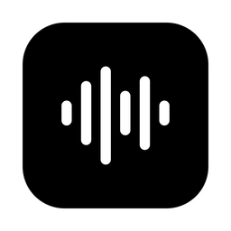
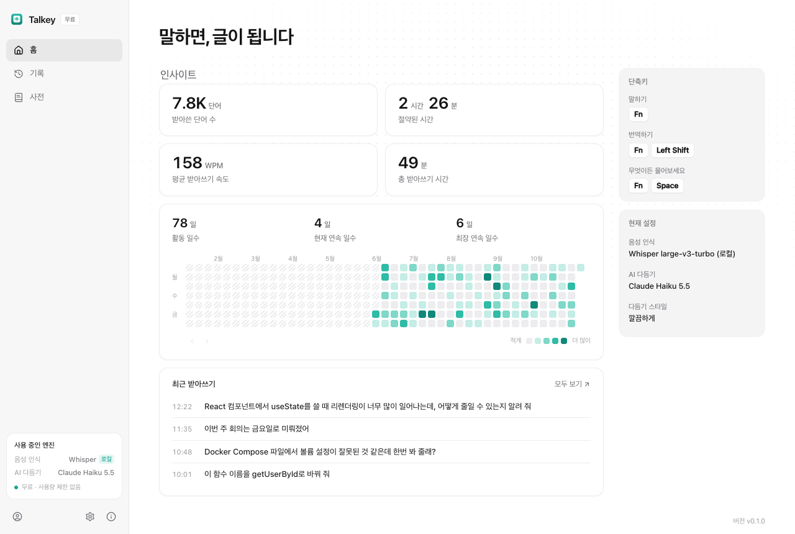
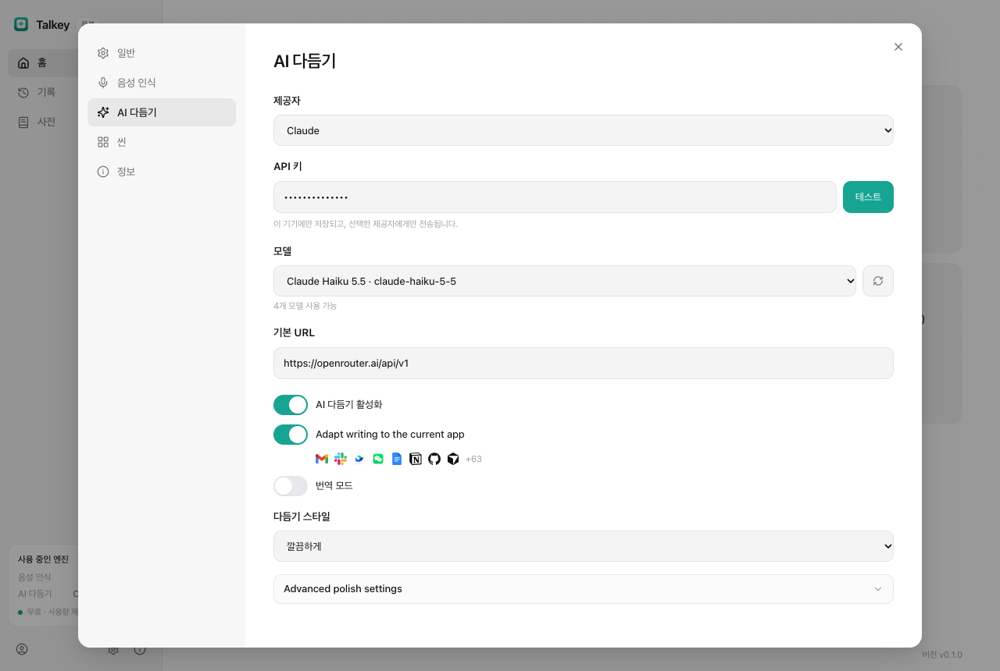

<p align="center">
  <a href="README.md">English</a> | <strong>한국어</strong>
</p>

<p align="center">
  
</p>

<h1 align="center">Talkey (토키)</h1>

<p align="center">
  키를 누르고 말하면, 지금 쓰는 앱에 다듬어진 글이 들어갑니다.<br/>
  macOS와 Windows용 무료 음성 입력 앱입니다. 로컬 Whisper를 기본으로 씁니다.
</p>

<p align="center">
  Talkey는 <a href="https://github.com/tover0314-w/opentypeless"><strong>OpenTypeless</strong></a>(MIT)의 포크입니다.
  OpenTypeless의 엔진을 그대로 쓰고, 매일 쓰면서 겪은 문제를 고쳤습니다.
  특히 한국어 받아쓰기와 단일 키 단축키 문제를 고쳤습니다.
</p>

<p align="center">
  
</p>

## 달라진 점

Talkey는 OpenTypeless v1.1.64를 기반으로 합니다. 아래는 모두 Talkey에서 새로 넣거나 고친 것입니다.

### 고친 문제

- **단일 키 단축키가 됩니다.** OpenTypeless의 단축키 녹화는 수정키 하나만 누르면 무시해서, 오른쪽 Command 같은 키를 지정할 수 없었습니다. Talkey는 오른쪽 수정키 하나를 그대로 기록하고 네이티브로 등록합니다.
  - macOS: 오른쪽 Command, 오른쪽 Option, 오른쪽 Control, 오른쪽 Shift
  - Windows: 오른쪽 Win, 오른쪽 Alt, 오른쪽 Ctrl, 오른쪽 Shift

  macOS에서는 그 키만 눌렀다 뗄 때만 동작하므로, 오른쪽 Command + C는 그대로 복사됩니다. 누른 채 말하기 모드에서는 잠깐 누르고 있으면 녹음이 시작됩니다.
- **한국어 군말을 지웁니다.** "어", "음", "그 뭐야" 같은 군말을 지우고, "X 아니 Y"처럼 고쳐 말한 부분은 Y만 남깁니다. 끝에 반복한 말을 지우고, 사전을 참고해 잘못 인식된 단어를 고칩니다. 영어 기술 용어는 영어로 둡니다.
- **사전이 음성 인식을 돕습니다.** 사전 단어를 Whisper에 `prompt` 힌트로 보냅니다(Custom Whisper, OpenAI Whisper, Groq Whisper). 시험해 보니 더 긴 힌트는 효과가 없어서 400자로 자릅니다.
- **원치 않는 업데이트가 없습니다.** 자동 업데이트 주소를 비워 두어서, 원본 프로젝트의 새 버전이 내 빌드를 덮어쓰지 않습니다.

### 새 기능

- **인사이트 홈 화면:** 받아쓴 단어 수, 아낀 시간, 평균 WPM, 연속 사용일, GitHub 잔디 같은 활동 그래프.
- **기록·사전 페이지 분리,** 대화상자로 열리는 설정.
- **Claude 모델 선택:** 다듬기 모델을 ID로 입력하지 않고 목록에서 고릅니다.
- **무료 빌드:** 업그레이드 안내가 없습니다. 내 API 키를 쓰거나 Whisper를 로컬에서 돌립니다.
- **OpenTypeless 자동 이전:** 처음 실행하면 OpenTypeless의 설정, 기록, 사전, 저장된 API 키를 복사해 옵니다. OpenTypeless 쪽 데이터는 건드리지 않습니다.

<p align="center">
  
</p>

## 지원하지 않는 것

- **OpenTypeless Cloud**(로그인, 구독, 관리형 음성 인식·다듬기)는 원본 프로젝트의 유료 서비스입니다. Talkey에서는 쓸 수 없습니다. 각 제공자의 API 키나 로컬 Whisper 서버를 쓰세요.
- **Linux:** 코드는 Linux에서도 빌드되지만, macOS와 Windows에서만 시험합니다.

## Whisper를 로컬에서 돌리기

Talkey는 OpenAI 호환 Whisper 서버라면 무엇이든 씁니다. 설정 → 음성 인식에서 **Custom Whisper**를 고르고 기본 URL을 `http://127.0.0.1:8000/v1`로 둡니다.

**macOS (Apple Silicon, Metal)** — [whisper.cpp](https://github.com/ggml-org/whisper.cpp):

```bash
brew install whisper-cpp
whisper-server -m ggml-large-v3-turbo.bin \
  --host 127.0.0.1 --port 8000 \
  --inference-path /v1/audio/transcriptions \
  -l ko --vad -vm ggml-silero-v5.1.2.bin
```

**Windows (NVIDIA GPU, CUDA)** — Docker로 [speaches](https://speaches.ai/)(faster-whisper):

```bash
docker run -d --name whisper-server --restart unless-stopped --gpus all -p 8000:8000 \
  -v speaches-hf-cache:/home/ubuntu/.cache/huggingface/hub \
  -e WHISPER__INFERENCE_DEVICE=cuda -e WHISPER__COMPUTE_TYPE=float16 \
  ghcr.io/speaches-ai/speaches:latest-cuda
curl -X POST localhost:8000/v1/models/deepdml/faster-whisper-large-v3-turbo-ct2
```

## 소스에서 빌드하기

아직 서명된 배포판이 없습니다. 직접 빌드하세요.

1. [Node.js](https://nodejs.org/) 20 이상, [Rust](https://rustup.rs/), 운영체제별 [Tauri 준비물](https://v2.tauri.app/start/prerequisites/)을 설치합니다.
2. 의존성을 설치하고 빌드합니다.

   ```bash
   npm ci
   npm run tauri build
   ```

3. 앱은 `src-tauri/target/release/bundle/`에 생깁니다.
4. macOS 빌드는 공증되지 않았습니다. 처음 실행하기 전에 ad-hoc 서명을 합니다.

   ```bash
   codesign --force --deep --sign - /Applications/Talkey.app
   ```

   그다음 시스템 설정에서 Talkey에 마이크와 손쉬운 사용 권한을 줍니다.

개발할 때는 `npm run tauri dev`를 씁니다.

## 출처와 라이선스

Talkey는 OpenTypeless Contributors가 만든 [OpenTypeless](https://github.com/tover0314-w/opentypeless)의 포크입니다. 원본 앱에 대한 공은 모두 그분들에게 있습니다. Talkey는 OpenTypeless 프로젝트와 관계가 없고, 그 프로젝트의 승인을 받지 않았습니다.

[MIT 라이선스](LICENSE)로 배포합니다. 라이선스 파일에 원본 OpenTypeless 저작권 고지를 그대로 두었습니다. 서드파티 고지는 [THIRD_PARTY_NOTICES.md](THIRD_PARTY_NOTICES.md)에 있습니다.
