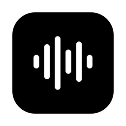
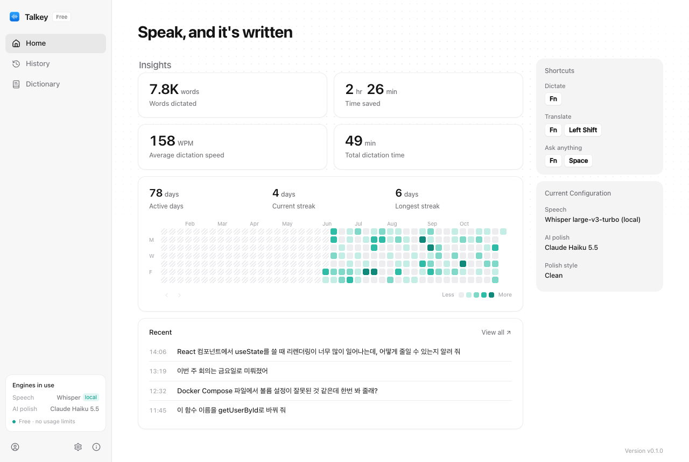
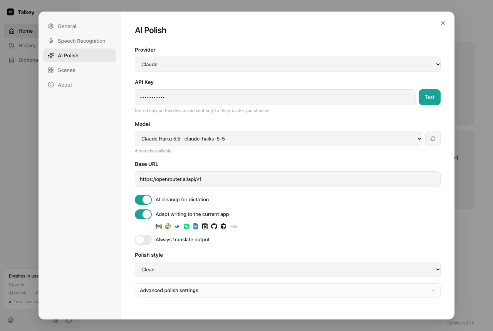

<p align="center">
  <strong>English</strong> | <a href="README.ko.md">한국어</a>
</p>

<p align="center">
  
</p>

<h1 align="center">Talkey</h1>

<p align="center">
  Press a key, speak, and get clean text in the app you are using.<br/>
  A free, local-first voice typing app for macOS and Windows.
</p>

<p align="center">
  Talkey is a fork of <a href="https://github.com/tover0314-w/opentypeless"><strong>OpenTypeless</strong></a> (MIT).
  It keeps the OpenTypeless engine and fixes problems I ran into as a daily user,
  especially with Korean dictation and single-key shortcuts.
</p>

<p align="center">
  
</p>

## What Talkey changes

Talkey is based on OpenTypeless v1.1.64. Everything below is new or fixed in Talkey.

### Fixes

- **Single-key shortcuts work.** In OpenTypeless the shortcut recorder ignored a lone modifier key, so you could not bind Right Command and similar keys. Talkey records a lone right-hand modifier and registers it natively:
  - macOS: Right Command, Right Option, Right Control, Right Shift
  - Windows: Right Win, Right Alt, Right Ctrl, Right Shift

  On macOS the key fires only when you tap it alone, so Right Command + C still copies. In hold-to-talk mode, recording starts after a short hold.
- **Korean filler words are removed.** The polish prompt now removes Korean fillers such as "어", "음" and "그 뭐야", resolves self-corrections ("X 아니 Y" becomes "Y"), drops trailing repeats, and fixes speech recognition errors using your dictionary. English technical terms stay in English.
- **Your dictionary helps speech recognition.** Dictionary words are sent to Whisper as a `prompt` hint (custom Whisper, OpenAI Whisper and Groq Whisper), capped at 400 characters because longer hints had no effect in testing.
- **No surprise updates.** The auto-updater points nowhere, so an upstream release never replaces your build.

### New

- **Home screen with insights:** words dictated, time saved, average WPM, streaks, and a GitHub-style activity grid.
- **Separate History and Dictionary pages,** and settings that open as a dialog.
- **Model picker for Claude:** choose the polish model from a list instead of typing its ID.
- **Free build:** no upgrade prompts. Bring your own API key or run Whisper locally.
- **Menu bar menu:** open Home, History, or Settings, add a dictionary word, and pick the microphone from the menu bar. Talkey remembers the microphone and falls back to the system default when it is unplugged.
- **Automatic import from OpenTypeless:** on first launch, Talkey copies your settings, history, dictionary and saved API keys from OpenTypeless. The OpenTypeless data is left untouched.

<p align="center">
  
</p>

## Not supported

- **OpenTypeless Cloud** (sign-in, subscriptions, managed speech and polish) is the upstream project's paid service. Talkey does not support it. Use your own provider keys or a local Whisper server.
- **Linux:** the code still builds for Linux, but I only test Talkey on macOS and Windows.

## Run Whisper locally

Talkey works with any OpenAI-compatible Whisper server. In Settings → Speech, choose **Custom Whisper** and set the base URL to `http://127.0.0.1:8000/v1`.

**macOS (Apple Silicon, Metal)** with [whisper.cpp](https://github.com/ggml-org/whisper.cpp):

```bash
brew install whisper-cpp
whisper-server -m ggml-large-v3-turbo.bin \
  --host 127.0.0.1 --port 8000 \
  --inference-path /v1/audio/transcriptions \
  -l ko --vad -vm ggml-silero-v5.1.2.bin
```

**Windows (NVIDIA GPU, CUDA)** with [speaches](https://speaches.ai/) (faster-whisper) in Docker:

```bash
docker run -d --name whisper-server --restart unless-stopped --gpus all -p 8000:8000 \
  -v speaches-hf-cache:/home/ubuntu/.cache/huggingface/hub \
  -e WHISPER__INFERENCE_DEVICE=cuda -e WHISPER__COMPUTE_TYPE=float16 \
  ghcr.io/speaches-ai/speaches:latest-cuda
curl -X POST localhost:8000/v1/models/deepdml/faster-whisper-large-v3-turbo-ct2
```

## Build from source

There are no signed releases yet. Build Talkey yourself:

1. Install [Node.js](https://nodejs.org/) 20 or later, [Rust](https://rustup.rs/), and the [Tauri prerequisites](https://v2.tauri.app/start/prerequisites/) for your OS.
2. Install the dependencies and build:

   ```bash
   npm ci
   npm run tauri build
   ```

3. Find the app in `src-tauri/target/release/bundle/`.
4. On macOS, the build is not notarized. Sign it ad hoc before the first launch:

   ```bash
   codesign --force --deep --sign - /Applications/Talkey.app
   ```

   Then allow Microphone and Accessibility access for Talkey in System Settings.

For development, run `npm run tauri dev`.

## Credits and license

Talkey is a fork of [OpenTypeless](https://github.com/tover0314-w/opentypeless) by the OpenTypeless Contributors. All credit for the original app goes to them. Talkey is not affiliated with or endorsed by the OpenTypeless project.

Released under the [MIT License](LICENSE). The original OpenTypeless copyright notice is kept in the license file. Third-party notices are in [THIRD_PARTY_NOTICES.md](THIRD_PARTY_NOTICES.md).
